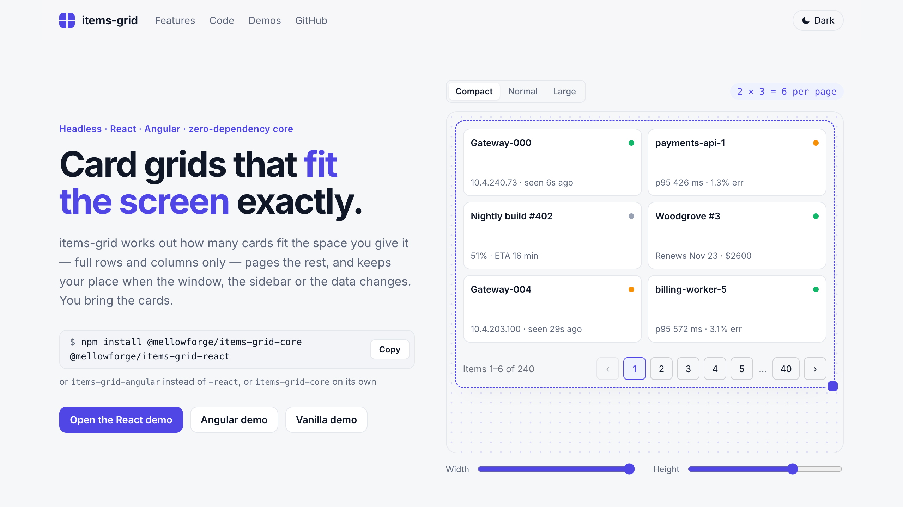

<div align="center">

# items-grid

**Card grids that fit the screen exactly — a headless layout and paging engine, with React and Angular adapters.**

[](https://www.npmjs.com/package/@mellowforge/items-grid-core)
[](https://www.npmjs.com/package/@mellowforge/items-grid-react)
[](https://www.npmjs.com/package/@mellowforge/items-grid-angular)
[](https://github.com/mellowforge/items-grid/actions/workflows/ci.yml)
[](https://bundlephobia.com/package/@mellowforge/items-grid-core)
[](packages/core/package.json)
[](LICENSE)

**[Live demo](https://mellowforge.github.io/items-grid/)** · [React demo](https://mellowforge.github.io/items-grid/react/) · [Angular demo](https://mellowforge.github.io/items-grid/angular/) · [Vanilla demo](https://mellowforge.github.io/items-grid/vanilla/) · [Docs](#documentation) · [Contributing](CONTRIBUTING.md)

<picture>
  <source media="(prefers-color-scheme: dark)" srcset="docs/images/demo-dark.png">
  
</picture>

</div>

## Why items-grid?

Dashboards keep rebuilding the same grid of entity cards — devices, jobs, services, accounts — and keep getting the same two things wrong: rows of uneven height, and pages that leave a half-visible row or an inner scrollbar. items-grid moves that logic into one place. **It measures the space it is given, shows exactly as many full rows and columns as fit, and pages the rest.** You render the cards; the library never ships card markup.

- **Exact fit** — `cols × rows` cards per page, never a partial row, never an inner scrollbar. A row height per size preset, or measured from a sample card (and re-measured when it resizes).
- **Keeps your place** — resizes, sidebars and preset changes recompute the page around the first card you were looking at, instead of jumping back to page 1.
- **Size presets** — `compact`, `normal`, `large` or your own, with `maxColumns` and `maxPageSize` caps.
- **Client or server paging** — slice an array, or ask your API for `{ pageIndex, pageSize }`: debounced while a window is dragged, deduplicated, with unknown totals supported.
- **Realtime without the jumps** — live reflow, or a stable page that keeps its cards and counts “N new items” for your banner. Cards keep their DOM by key, so switches and focus survive updates (in the vanilla mount, pass `updateItem` to patch a changed card in place).
- **Accessible** — list semantics, a polite live region, a labelled pager, PageUp / PageDown, and opt-in arrow keys between cards that leave card controls their own keys.
- **Headless, zero dependencies** — a pure, zero-dependency engine with a vanilla mount and thin React and Angular adapters, in parity. The core and the React adapter render on the server.

## Packages

| Package                                                                          | What it is                                                                      |
| -------------------------------------------------------------------------------- | ------------------------------------------------------------------------------- |
| [`@mellowforge/items-grid-core`](packages/core#readme)                           | The headless engine and controller, plus `mountItemsGrid` for plain DOM.        |
| [`@mellowforge/items-grid-react`](packages/react#readme)                         | `<ItemsGrid>`, `useItemsGrid` and `<ItemsGridPager>` for React 18 and 19.       |
| [`@mellowforge/items-grid-angular`](packages/angular/projects/items-grid#readme) | `<mf-items-grid>` with template directives for Angular 22+. No Material or CDK. |

The adapters have the same options, the same markup and the same `--mf-items-grid-*` theming properties.

## Installation

```bash
npm install @mellowforge/items-grid-core @mellowforge/items-grid-react     # React
npm install @mellowforge/items-grid-core @mellowforge/items-grid-angular   # Angular
npm install @mellowforge/items-grid-core                                   # anything else
```

Keep every `@mellowforge/items-grid-*` package on the same version — they are released in lockstep.

| Peer dependency                    | Needed by                                           |
| ---------------------------------- | --------------------------------------------------- |
| `@mellowforge/items-grid-core`     | both adapters (`0.x` — keep it on the same version) |
| `react`, `react-dom`               | `@mellowforge/items-grid-react` (`^18 \|\| ^19`)    |
| `@angular/core`, `@angular/common` | `@mellowforge/items-grid-angular` (`>=22`)          |

## Quick start

Give the grid a container with a **definite height** from your layout (e.g. `flex: 1; min-height: 0` in a flex column), your items, a `getKey` and a card template. The optional stylesheet themes the pager and the focus ring of cards (with `arrowKeys`).

### React

```tsx
import '@mellowforge/items-grid-core/styles.css'; // optional pager and focus-ring theme

import { ItemsGrid } from '@mellowforge/items-grid-react';

interface Device {
  id: string;
  name: string;
  status: string;
}

export function Devices({ devices }: { devices: Device[] }) {
  return (
    <ItemsGrid
      // The grid fills the height your layout gives it: here, what a flex column leaves.
      style={{ flex: 1, minHeight: 0 }}
      aria-label="Devices"
      items={devices}
      getKey={device => device.id}
      preset="compact"
      arrowKeys
      renderItem={device => (
        <article className="device-card">
          <h3>{device.name}</h3>
          <p>{device.status}</p>
        </article>
      )}
    />
  );
}
```

### Angular

```ts
import { Component, input } from '@angular/core';
import { MfItemsGrid, MfItemsGridItem } from '@mellowforge/items-grid-angular';

interface Device {
  id: string;
  name: string;
  status: string;
}

@Component({
  selector: 'app-devices',
  imports: [MfItemsGrid, MfItemsGridItem],
  template: `
    <mf-items-grid
      class="devices-grid"
      ariaLabel="Devices"
      [items]="devices()"
      [getKey]="byId"
      preset="compact"
      [arrowKeys]="true"
    >
      <ng-template mfItemsGridItem [mfItemsGridItemOf]="devices()" let-device>
        <article class="device-card">
          <h3>{{ device.name }}</h3>
          <p>{{ device.status }}</p>
        </article>
      </ng-template>
    </mf-items-grid>
  `,
  // The grid fills the height your layout gives it: here, what a flex column leaves.
  styles: `
    :host {
      display: flex;
      flex-direction: column;
      height: 100%;
    }
    .devices-grid {
      flex: 1;
      min-height: 0;
    }
  `,
})
export class Devices {
  readonly devices = input.required<Device[]>();
  readonly byId = (device: Device) => device.id;
}
```

Import the optional theme once from a global stylesheet: `@import '@mellowforge/items-grid-core/styles.css';`.

### Any framework, or none

```ts
import '@mellowforge/items-grid-core/styles.css'; // optional pager and focus-ring theme

import { mountItemsGrid } from '@mellowforge/items-grid-core';

interface Device {
  id: string;
  name: string;
  status: string;
}

function renderDevice(device: Device): HTMLElement {
  const card = document.createElement('article');
  card.className = 'device-card';
  const name = document.createElement('h3');
  name.textContent = device.name;
  const status = document.createElement('p');
  status.textContent = device.status;
  card.append(name, status);
  return card;
}

// The container needs a definite height from your layout (e.g. flex: 1; min-height: 0).
export function showDevices(container: HTMLElement, devices: Device[]) {
  const grid = mountItemsGrid(container, {
    ariaLabel: 'Devices',
    items: devices,
    getKey: device => device.id,
    preset: 'compact',
    arrowKeys: true,
    renderItem: renderDevice,
  });
  // Realtime updates: pass a new array. Unchanged items keep their card; pass updateItem to
  // patch a changed card in place.
  return (next: Device[]) => grid.update({ items: next });
}
```

## How it fits

```text
cols     = max(1, floor((width  + gap) / (minCardWidth + gap)))
rows     = max(1, floor((height + gap) / (rowHeight    + gap)))
pageSize = cols × rows            (cols capped by maxColumns; maxPageSize trims rows, then cols)
```

The grid measures only its own viewport (a `ResizeObserver`, one report per frame), so toolbars, banners and the pager never need a hard-coded offset — they sit outside it. The layout is CSS Grid with tracks computed in JS and applied inline, so it works without any stylesheet, the last row stays aligned and the page size is exact. When the size changes, the grid reanchors on the first card of the page; in server mode a drag-resize sends one debounced request.

## Documentation

- **[Core](packages/core#readme)** — every option, server mode, realtime (live and stable), the controller, accessibility, arrow keys, styling and dark mode.
- **[React](packages/react#readme)** — props, SSR, the imperative handle and `useItemsGrid` for custom markup.
- **[Angular](packages/angular/projects/items-grid#readme)** — inputs, outputs, template directives (item, skeleton, empty, pager) and the template reference.
- **Design** — the [Figma prototypes](https://www.figma.com/design/fZ2yYLtFiO2N7aM0Ai97E4) (presets × viewports, states, slack alignment) and the [engine diagrams](https://www.figma.com/board/gVi3M0uhf7sCApNT2bybFh).

## Compatibility

- **React** 18 and 19, including server rendering (no layout-effect warnings; the grid fills in after hydration).
- **Angular** 22+, signal inputs, zoneless-ready (zone.js not required).
- **Browsers**: current Chrome, Edge, Firefox and Safari (`ResizeObserver`, CSS Grid). The pager theme's automatic dark accent needs `light-dark()`; older browsers keep the light accent.

## Limitations

- **One card size per grid.** Mixed sizes, masonry and spanning cards are out of scope.
- **Paging, not scrolling.** No virtual or infinite scroll — the grid shows whole pages.
- **The height comes from your layout.** The grid fills the box it is given and never sizes itself to its content.
- **Your data, your rules.** Sorting, filtering and fetching stay in the app; the grid lays out what it gets.

## Contributing

Bug reports, docs fixes and pull requests are welcome — see [CONTRIBUTING.md](CONTRIBUTING.md) for the setup, the development loop and the rules every change follows (TDD, adapter parity, exact fit verified in a browser).

## License

[MIT](LICENSE) © 2026 Konstantin Penzin
